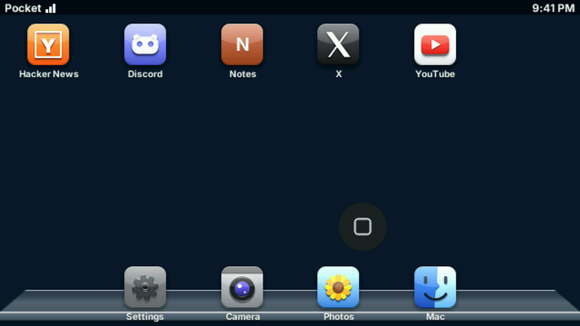
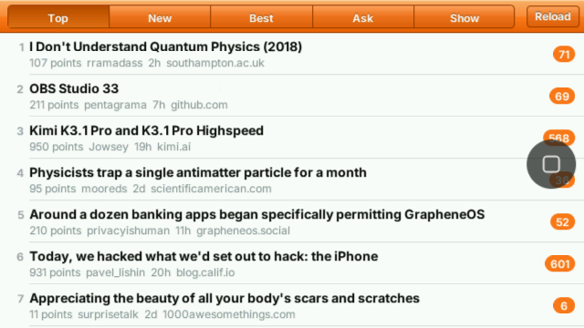
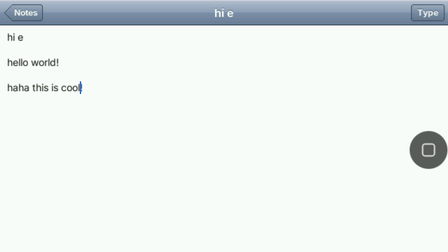
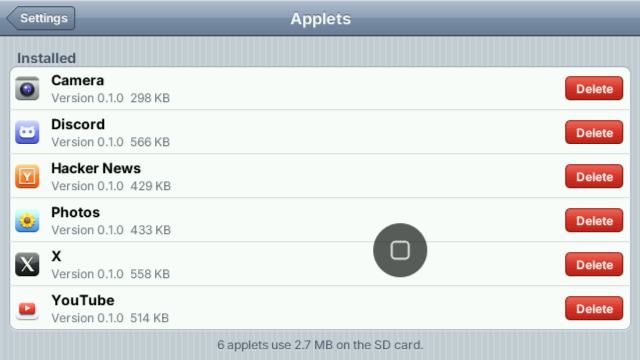
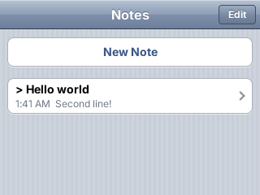

# Pocket Shell

Pocket Shell is **Pocket Home** and its **Pocket Applets**: a launcher and
a set of apps built on [PocketJS](https://github.com/pocket-nexus/pocketjs)
that run from one set of packages on the Nintendo 3DS's touch screen and on
the M5Stack Tab5's landscape panel.

| Home | Hacker News | Notes |
| --- | --- | --- |
|  |  |  |

| YouTube | Camera | Settings |
| --- | --- | --- |
|  |  |  |

| Home on the 3DS | Notes on the 3DS |
| --- | --- |
|  |  |

The Tab5 pictures are the device's framebuffer at its logical **640x360**
(the panel shows it at 2x); the 3DS Home picture is a capture from the
console, and the 3DS Notes list is a simulator render at 320x240. Each
applet lays itself out by size class from one source, so the 3DS and the
Tab5 install the same programs: see [shells/3ds](shells/3ds/README.md).

## The shells as explorations

The repository holds three shells, and two more on an archive branch. Each
explored one way of operating a small computer; what each taught is in
[docs/EXPLORATIONS.md](docs/EXPLORATIONS.md).

| Shell | Modality explored | Source and documentation |
| --- | --- | --- |
| Pocket Home on the 3DS and the Tab5 | A touch-screen launcher with installed applets; on the 3DS, Claude's room on the top screen and L+R to talk or type; on the Tab5, a floating home ball and a keyboard | [shells/3ds](shells/3ds/README.md) |
| Touch navigation | Full-screen gestures over sixteen mock apps on the iPod touch 4 and the Nokia E7 | [shells/touch](shells/touch/README.md) |
| Desktop OS | Windows, a pointer and a keyboard, with Classic 98, XP and Aqua themes on macOS and Linux and a browser preview; the shell Pocket Studio uses | [shells/desktop](shells/desktop/README.md) |
| The Omarchy-style 3DS shell and the iPod touch 4 remote (archived) | Tiling windows on the top screen with shoulder chords and a deck on the touch screen; a handheld that mirrors and controls a Linux desktop | branch [`archive/3ds-omarchy-ipod-remote`](https://github.com/pocket-nexus/pocket-shell/tree/archive/3ds-omarchy-ipod-remote) |

The former **pocket-desktop** project is the desktop OS shell in this
repository. Its application code, assets, tests, native build scripts, browser
preview, website and benchmark history are maintained under `shells/desktop/`.
The import preserves its Git history. Existing installed package IDs and
desktop artifact names remain stable. The archived shells are `main` at
`78b94b2` before they were removed; they are not built or tested on `main`, and
work on one starts from the archive branch, whose README and `AGENTS.md`
describe that tree.

## Repository layout

```text
shells/
  3ds/       home, the applets (hn, youtube, x, discord, camera, photos, notes) and ui, scripts, test, media, manifests
  touch/     src (gesture model and mock apps), scripts, test, manifest
  desktop/   src/system-ui, scripts, test, assets, docs, preview, site, manifests
scripts/     setup, desktop command dispatch, repository paths and process helpers
vendor/
  pocketjs/  shared runtime submodule
```

The three shells have separate Bun packages and TypeScript configurations.
See the [asset policy and review](docs/ASSETS.md) for generated outputs,
source inputs and retained documentation fixtures. Application code is separate;
runtime APIs come from `@pocketjs/framework/*`.

## Development

Run commands from the repository root. Bun, Rust and the
`wasm32-unknown-unknown` Rust target are required for the complete check.
Native targets have additional requirements in their shell's README.

```sh
git clone --recurse-submodules https://github.com/pocket-nexus/pocket-shell.git
cd pocket-shell
bun run setup
rustup target add wasm32-unknown-unknown
bun run check                    # types, unit and simulator tests for all shells
bun run check:3ds                # or check:touch / check:desktop
```

```sh
bun run desktop macos            # build and launch on macOS
bun run desktop linux            # build and launch on Linux
bun run desktop web              # interactive browser preview
bun run desktop build            # macOS release build without launching
bun run desktop package:linux    # relocatable Linux distribution
bun run desktop test:web         # browser interaction smoke test
bun run desktop build:site
bun run desktop test:site
```

Desktop outputs are in `shells/desktop/dist/`. Use `bun run desktop --help`
to list its commands, including captures, benchmarks and the text companion.

```sh
bun run deploy --host <console-ip> # build Home's .3dsx, install it over the wire and restart into it
bun run push [hn] --host <console-ip>  # rebuild and hot-push Home (or install Hacker News)
bun run offer                    # offer the applets (3DS and Tab5 packages) through the running Pocket Companion
bun run tab5 [app…]              # build Home and the applets for the M5Stack Tab5 into dist/tab5
bun run shot --host <console-ip>  # capture both console screens
bun run 3ds                      # full console binary in dist/3ds
bun run touch guest
bun run touch deploy             # portrait gesture shell on the connected iPod
```

PocketJS is pinned through `vendor/pocketjs`, including the 3DS host's agent
stage and the Pocket Link. Runtime changes belong upstream; this repository
selects their commit through its submodule pin.

## License

**GNU GPL version 3.** Root, 3DS and touch code uses
`GPL-3.0-or-later`; imported desktop code retains `GPL-3.0-only`.
PocketJS and third-party fonts retain their own licenses. See
[LICENSING.md](LICENSING.md), [LICENSE](LICENSE) and
[contribution rules](CONTRIBUTING.md).
