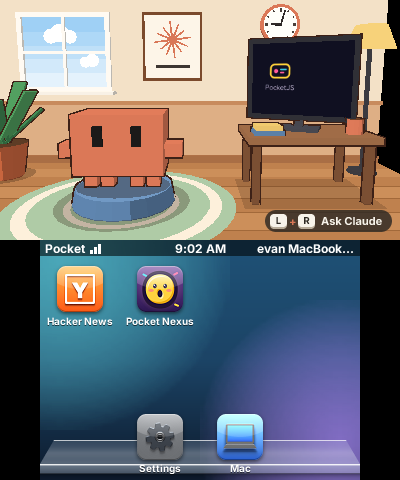
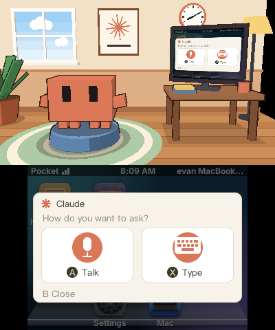
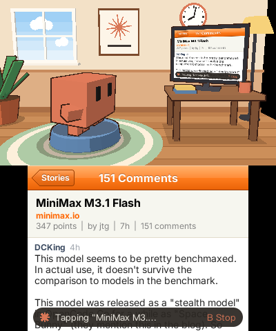
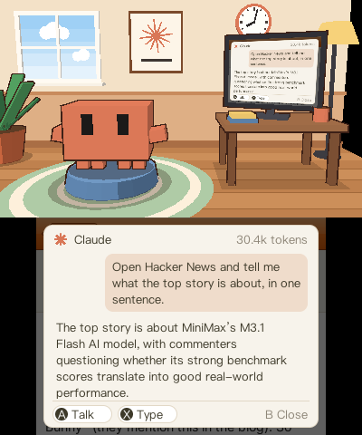

# Pocket Shell on the 3DS and the M5Stack Tab5

This shell is **Pocket Shell**, the console's launcher, and the scripts that
build it with the **Pocket Applets** of pocket-nexus/applets for the
Nintendo 3DS, the M5Stack Tab5 and the PSP. On the 3DS every applet draws
on the touch screen and nowhere else. The top screen belongs to the system: for each applet (each declares the
capability `system.agent`), the PocketJS 3DS host draws Claude's room
there, and **L+R opens the agent over any applet**. The runtime side (the room, the overlay, the
companion's agent) is PocketJS's and is described in
[POCKET-AGENT.md](../../vendor/pocketjs/docs/POCKET-AGENT.md) in the pinned
submodule. On the Tab5 the same programs lay out for its one landscape panel;
see [The M5Stack Tab5](#the-m5stack-tab5).

| Home | L+R | The agent at work | The reply |
| --- | --- | --- | --- |
|  |  |  |  |

These are screenshots from an Old 3DS. The third and fourth come from one
typed request ("Open Hacker News and tell me what the top story is about"),
which took **30.4k tokens**.

## The launcher and the applets

An applet is a Pocket app whose app contract (`pocket.app.json`) declares
the section `applet` and meets the applet rules (PocketJS
[APPLETS.md](../../vendor/pocketjs/docs/APPLETS.md)): one touch surface
that admits 320×240, the agent enhanced, an allowlist of capabilities, the
companion services it reaches declared (`applet.services`), no native code
and no code evaluation, bundle and pak budgets. The PocketJS build refuses an
applet that breaks a rule. The launcher is an app, not an applet: it pairs,
installs and switches, which applets cannot.

**The applets live in [pocket-nexus/applets](https://github.com/pocket-nexus/applets)**,
a submodule here at `vendor/applets`: one source that builds for the 3DS, the
Tab5 and Omarchy Pocket, with its own rules, sims and sample data (`bun run
check` there), and the store at applets.pocket.nexus. The scripts here build
the launcher from `shell/` and every applet the submodule has for a console
from `vendor/applets` (its own project root), with this repository's PocketJS.

| Program | Directory | Package | Reaches the console |
| --- | --- | --- | --- |
| Pocket Shell | `shell/` | `dev.pocket-nexus.shell`, `pocket-shell` | embedded in the `.3dsx`; the launcher |
| Hacker News, YouTube, X, Discord, GitHub, Weather, Podcasts, Maps, Home, Camera, Photos, Notes | `vendor/applets/<name>/` | `dev.pocket-nexus.<name>`, `<name>-main` | installed through the launcher from the linked Mac, or pushed |

`ui/` (a link to `vendor/applets/ui`) is the iOS 6 kit the launcher and the
applets build on at the 3DS's 0.82 scale: the navigation stack and bar,
grouped tables, alerts, text fitting, a slot pool for long lists and one
stylus router per screen.

**An applet's network is its worker.** The UI realm has no network: an
applet that declares `net.http` declares the worker in `lib/net-worker.ts`
of pocket-nexus/applets (`domains.worker`: one `http` node and a ring each
way, the same in every app contract), and `lib/net.ts` gives its UI a `fetch`
over those rings (records in `lib/net-wire.ts`). The host's node runs two requests at once and
the worker holds the rest. One request's descriptor (URL, method, headers
and body as JSON) is at most **1020 bytes**: a longer post or reply is
refused with `invalid_request`, and a glyph atlas is asked for in parts that
`ui/glyphs.ts` merges into one atlas before it loads. On the 3DS the node
rides the Pocket Link to the Mac as a `net.http` request that Pocket Hub
performs, and only while Hub lists `net.http` (PocketJS
`docs/POCKET-LINK.md` §6.1, §6.5); without it the request fails at once.
On the Tab5 it is the firmware's HTTP over
Wi-Fi, and a request to `companion.pocket` goes over the Pocket Link to the
paired Mac (pocket-m5 v0.1.2).

### Surfaces

Every manifest declares an adaptive surface, `app.surfaces.auxiliary.adaptive`
from **320×240 to 640×720**, and lays out at the size the host presents.
`ui/screen.ts` is the one place that reads it (`SCREEN_W`, `SCREEN_H`, set by
`readScreen()` as each program's root component starts) and names the size
classes:

| Class | Surfaces | Layout |
| --- | --- | --- |
| `COMPACT` | the 3DS touch screen, 320×240 | as drawn for it; the sims' 320×240 screenshots stay byte-identical |
| landscape | the M5Stack Tab5's 640×360 (the sims also run 592×360), the PSP's 480×272 | the iOS 6 apps held sideways |
| `TALL` | portrait, such as 360×592 | the iOS 6 phone apps |

On a surface larger than the 3DS's:

- The springboard fits columns of about 96 px and rows of at least 74 px
  (90 px in portrait) over the dock: **six by three** on 640×360, four by
  five on 360×592. Its wallpaper is flat discs on a flat field: an RGB565
  panel draws a smooth gradient this large as visible steps.
- Lists, tables, headers and composers span the width, and each list shows
  as many rows as its height holds.
- A **Reload** button in the bar stands in for the X and Y reload buttons
  (Hacker News, YouTube, X, Discord's servers and channels, Photos), and
  YouTube's player has **-** and **+** for the volume.
- YouTube's player fits the largest 16:9 picture over its control bar;
  Camera's preview is as tall as the surface with its bar down the right
  side; Photos fits as many 80 px columns as the width holds.
- Settings > Wi-Fi scans, joins with a password typed on the keyboard, and
  forgets saved networks on a host whose launcher is its settings
  (`wifiCanJoin()`); the 3DS keeps its saved-slot page.

Icons ship an `@2x` texture beside each 1x one (pocket-nexus/applets `tools/icons/bake.ts`), so
a density-2 build draws them texel for texel. `POCKET_TAB5_SHOTS=<dir> bun run
check:3ds` also writes the launcher's 592×360 and 360×592 screens; the
applets' are pocket-nexus/applets' sims.

### The PSP

Pocket Shell runs on the PSP's whole 480×272 screen from the same entry. Its
app contract adds the applet full-screen presentation (`{screens: 1, touch:
"none", buttons: true}`, PocketJS `docs/APPLETS.md`), so the psp host
contract compiles it with no auxiliary surface; `AppletSurface` mounts it on
the screen and `readScreen()` reads the size from `appletViewport()`.

Without touch every page is read by its d-pad focus, which the first row or
icon holds from the start, and a **22 px button legend** along the bottom
(`ui/legend.tsx`) names what each button does on the page in front: ○ for
the focused row, × for back, then the page's own (L and R for feeds and
pages, △ for reload or write, □ for edit or reload), and SELECT for the home
screen in an applet. An alert and the system keyboard put their own buttons
there while they are open. On a touch surface the legend draws nothing and
the layouts keep their full height.

The applets come from pocket-nexus/applets with the same button paths, and
there Hacker News, YouTube, X, Discord and GitHub declare the same
presentation (pocket-nexus/applets#6). The PSP cannot run them yet: their
network is a worker with an `http` node, and the psp host contract at the
pinned PocketJS provides neither `runtime.worker` nor `net.http` (PocketJS
`docs/POCKET-LINK.md`, "USB carrier"). The resolver leaves them out of the
PSP build, as it leaves out every applet without the presentation, which
needs a touch surface.

`bun run psp` resolves every app for the psp host contract, compiles each
one that resolves into `dist/psp/packages/` with the admission check `bun run
tab5` makes, and links one EBOOT with Pocket Shell as app 0 and the others
embedded after it (PocketJS `tools/psp.ts`, which needs `pocket target add
psp`). At the pinned PocketJS that EBOOT holds the launcher alone. Under
PSPLINK the PRX runs from the share the tethered computer serves, and that
computer's companion keeps the link in the same share with Pocket Link 1's
USB carrier. That companion left PocketJS for Pocket Hub (PocketJS #672).
Every device is to speak Pocket Link 2, which has no USB carrier yet
(`docs/POCKET-LINK.md` §2.0, §11); the PSP moves to it with one. A console
linked this way shows no store, and Settings names its companion:

```sh
usbhostfs_pc /opt/pocket/host0 &
pspsh -e "ldstart host0:/pocketjs-psp.prx"   # after copying the PRX into the share
```

### The M5Stack Tab5

The Tab5 target is pocket-m5's `programs/m5stack-tab5` with the host
contract `tab5-home` (`pocket.host.json`, which its `pocket.host.config.ts`
names): an ESP32-P4 whose 1280x720 panel
shows the auxiliary surface at **640x360 logical, presented at 2x**, turned
onto the portrait panel. The firmware builds this launcher (`shell/`, from
its `third_party/pocket-shell` submodule) and embeds it, keeps the installed
applets on its `apps` flash partition and their data on the microSD card,
and boots one runtime per app; the applets install from the Mac's catalog as
on the 3DS, or from an install code (below). The six
pictures at the top of the repository README are this surface. pocket-m5's
releases are the firmware.

- `bun run tab5 [app…]` compiles each app against the Tab5 host config
  into `dist/tab5/<output>.pocket` and refuses a package the host contract
  does not admit. The check is PocketJS's admission
  (`contracts/spec/admission.ts`), the rules the firmware applies when it
  opens a package: the binding generation, raster density, animation class,
  viewport, presentation and auxiliary surface match, the tick rate is a
  whole multiple of a host cadence (an applet's 60 Hz runs two core ticks
  per 30 Hz frame on the Tab5), and every enabled feature is a host
  capability. The host config is read from a
  [pocket-m5](https://github.com/pocket-nexus/pocket-m5) checkout:
  `POCKET_M5_ROOT` when set (relative to the repository root), else
  `../pocket-m5` beside this repository. A firmware built with
  `-DPOCKETJS_TAB5_SHELL_PACKAGE=<package.pocket>` embeds a launcher package
  from here in place of the one it compiles from its submodule.
- **Installs from a code.** Where the firmware binds `globalThis.installer`
  into the launcher (the Tab5), the Mac store shows a Scan a Code... row
  above its list. The scanner reads an install URI
  (`pocketlink://install?v=1&a=<app id>&s=<sha256>[&n=<title>]&u=<url>`,
  pocket-m5 `components/pocket_system/README.md`, "Installs from a code"),
  closes the camera and shows the app's title and the server's host with
  Install and Cancel; the download's progress, then Open or the firmware's
  error, follow on that page. `shell/system.ts` parses the URI, starts the
  download and polls the installer every frame while it runs. The scanner
  reads install codes only; no code pairs a device (below). A host without
  the installer shows no row.
- The Pocket Hub app carries the applets and offers them to a paired Tab5
  or 3DS. `bun run offer` builds both the 3DS and the Tab5 package of every
  applet into `dist/3ds/apps/` and serves that folder as the catalog of
  PocketJS's reference Pocket Link 2 Hub (`tools/3ds-dev.ts serve --apps`),
  which lists to each device the files with a variant for its target. A
  Tab5 links to it once its firmware speaks Pocket Link 2.
- The Tab5 has no buttons. The firmware paints a **floating home ball** over
  the picture: a tap sends SELECT (back to Home, or the launcher summoned
  from an app), a finger that moves at once drags the ball inside the
  picture, and a finger that rests and then slides makes a gesture, logged by
  its direction, where an effect attaches later. A touch on the ball never
  reaches a program.
- The **Tab5 keyboard** (M5Stack A164, I2C on Ext.Port1) types through
  PocketJS's text events (`onTextEvent` from `@pocketjs/framework/input`,
  capability `input.text`): a character commits, a named key arrives as a
  `KeyboardEvent.key` name (`Enter`, `Backspace`, `ArrowLeft`). An open
  system-keyboard session takes the keyboard itself, so the Wi-Fi password
  field and Notes fill from the keys with no change in the apps; Notes also
  reads the keys on its editor page. The keyboard's firmware keeps its Ctrl
  bit set once Ctrl was pressed, so the host reads no modifier from it.
- **Notes** keeps `notes/<id>.txt` and `notes/index.json` in the applet's
  `data.fs` tree, the microSD card on the Tab5 and the SD card's slot on the
  3DS; it saves a second after the last edit and when its editor closes.
- The Tab5 is a repaint display without a compositor, so its animation class
  is `repaint`: the launcher keeps a flat wallpaper, cuts where the 3DS zooms and
  wiggles, and its navigation stack cuts where the 3DS slides.

**The launcher** is the springboard (the home screen), Settings (Wi-Fi, the
paired Macs, the installed applets), the Mac (the applets the paired Mac
offers, with GET, OPEN and UPDATE) and the clock, which reads the Mac's
time over the Pocket Link.

**Pocket Hub sets a device up; no code pairs one.** Every device speaks
Pocket Link 2, which has no pairing on the wire: no QR code, no camera and no
pairing window (PocketJS `docs/POCKET-LINK.md` §3). Pocket Hub writes the
pairing files onto the device's storage (on a 3DS `sdmc:/pocketjs/link/`,
through ftpd or with the SD card in the computer's reader) when it installs
Pocket Shell, and the device dials that computer from its next start.
Settings > Mac says so and lists the paired Macs with Forget; forgetting one
deletes its file on the card, and linking to it again takes another setup
from that Mac. The launcher never calls `link.pair`.

The Mac page and the store follow the features the link lists (§6.1): a
linked Mac that lists no `catalog` gets "No Applets Offered" in the store
instead of a request, and the Mac page says which of applets and web
requests (`net.http`) that Mac carries.

The springboard holds **four columns by two rows
a page** above a dock of up to four icons (Settings, Camera, Photos, Mac).
Labels are bold 10 px (`text-2xs`), so "Hacker News" and "Pocket Nexus" fit
their 80 px cells; a longer name ends in "...".

- A drag moves the row of pages with the stylus. A flick faster than
  **250 px/s** turns the page; a slower release settles on the nearest page.
  Past the first or last page the row resists (a 160 px pull moves it 69 px).
- The d-pad's left and right turn the page at the grid's edges. L and R do
  not page: a lone shoulder press reaches an app six frames late, because the
  host waits that long for the L+R chord.
- Page dots above the dock follow the drag.

**The icons are pocket-nexus/applets' icon family.** `shell/art/icons` is a
link to `vendor/applets/ui/art/icons`: the launcher's own icons (Settings,
Mac, Wi-Fi, Apps, Pocket Nexus) and every applet's, rendered in Blender at
512 px by `tools/icons/icons.py` there and given one finish by
`tools/icons/bake.ts` (the rounded mask, the iOS 6 gloss, a lit top rim, a
shaded bottom rim and, at 46 px, a drop shadow) at 24, 46 and 64 px and
`@2x`. `ui/icons.tsx` maps an app id to its icon and draws the tile; an
applet's `icon.png`, the picture its package carries and the store lists, is
the same 64@2x texture. A new icon is made and committed there (`bun run
icons --only <name>` in pocket-nexus/applets), never here.

**An app without baked art gets a glyph.** Its tile is a tint from its id
under a four-square applet glyph and the `plain` finish, so it has the same
gloss, rim and shadow as the baked icons (`ui/icons.tsx` `appTint`). **No
tile shows an app's initials.**

**YouTube, X and Discord** reach their services through the linked Mac:
each applet fetches `https://companion.pocket/<service>/…`, which Pocket
Hub answers itself (the services left PocketJS with the companion, PocketJS
#672). Accounts, tokens and tools stay on the Mac; the console never holds
them. The companion answers a service only for an app in its catalog whose
manifest lists that service in `applet.services`; any other request gets
403. On a Pocket Link 2 console that fetch is a `net.http` request, so it
needs a Hub that serves `net.http` and still answers `companion.pocket`:
whether Pocket Hub keeps answering it beside applet channels is open
(PocketJS `docs/POCKET-LINK.md` §11), and the reference Hub of `bun run
offer` refuses it ("this Hub runs no services").

- **YouTube** lists topic feeds and search results from yt-dlp, with
  thumbnails the companion renders into textures. The Mac needs yt-dlp and
  ffmpeg: Pocket Hub's YouTube page downloads them, or `brew install
  yt-dlp ffmpeg`. A New 3DS plays H.264 through its hardware decoder; an **Old 3DS plays 240×136 at about 12 fps**
  in PAL8 (a fixed 252-colour cube, only changed pixels sent), with sound,
  at 58 to 215 KB/s. Sound needs the console's DSP firmware once: Rosalina
  menu (L + Down + SELECT) > Miscellaneous options > Dump DSP firmware.
- **X** reads the Following and For You timelines and threads through the
  session of an account signed in on the Mac: Pocket Hub's X page opens a
  sign-in window there.
  It uses x.com's web API, which X changes without notice. Setup and controls: [docs/X.md](../../vendor/applets/docs/X.md).
- **Discord** reads and sends in the servers a bot is in: create a bot in
  the Discord developer portal, turn on its Message Content intent, then
  give the token to Pocket Hub's Discord page. Setup and controls:
  [docs/DISCORD.md](../../vendor/applets/docs/DISCORD.md).

**GitHub** is built from the applets' `kit/`, a design system in which a page is rows
and the kit draws them (`kit/platform.tsx` is what it takes from the device,
the same on every device): the inbox, pull requests, issues, repositories, code, diffs,
reviews, merging, Actions, releases, gists and search, on GitHub's REST API
with ETags and the Link header's pages. Its token is kept by the
companion's `store` service, avatars come through `images`, and text in any
script through `glyphs`. Its 16 px marks are geometry in `kit/icons.gen.ts`.

**Hacker News** lists Top, New, Best, Ask and Show and opens a thread with
the story and every comment in full. Its requests go to
`hacker-news.firebaseio.com` through the applet's worker, which on the 3DS
rides the Pocket Link to the Mac.

## The agent

L+R opens a card over the paused applet with two choices: **Talk (A)** records
until A or Send, and **Type (X)** opens the keyboard; START sends. While the
agent operates the applet the card shrinks to a banner and B stops it. On the
top screen the mascot listens, thinks and types at its own monitor, which
shows the touch screen or the agent's own copy of an applet, and the PocketJS
mark as a screensaver while it rests. A pill in the
bottom-right corner reads "L+R Ask Claude" while the mascot is idle.

The agent needs **Pocket Hub** on the Mac, signed in to Codex (its
Assistant page signs in), and on a Pocket Link 2 console a Hub that lists
the `agent` feature (PocketJS `docs/POCKET-LINK.md` §6.1, §6.6); without it
the agent stage reads the link as unavailable. Pocket Hub is not released yet. The
app carries the applets; `bun run offer` serves the ones built here from
PocketJS's reference Hub instead.

## Commands

Run from the repository root.

```sh
bun run pair --host <console-ip>        # once, while ftpd runs: write this computer's pairing onto the card
bun run deploy [--host <console-ip>]    # build pocket-shell.3dsx, install it over the link, restart into it
bun run push [--host <console-ip>]      # rebuild the launcher's package and hot-push it
bun run push hn [--host <console-ip>]   # rebuild Hacker News, install it into its slot and start it
bun run offer [--3ds|--tab5]            # build the applets' 3DS and Tab5 packages and serve them from the reference Hub
bun run shot [--host <console-ip>]      # one screenshot of both screens
bun run probe [--host <console-ip>]     # the program's status and one screenshot
bun run 3ds [shell|hn] [--pocket-only]  # build into dist/3ds
bun run tab5 [app…]                     # build packages for the M5Stack Tab5 into dist/tab5
bun run psp [--skip-eboot]              # build Pocket Shell's PSP EBOOT into dist/psp
bun run check:3ds                       # typecheck, the launcher's and the applets' sims, unit tests
```

These commands run PocketJS's 3DS development tool (`tools/3ds-dev.ts`),
the reference Pocket Link 2 Hub's command line: the console dials this
computer, so `--host` only adds its address as a beacon target, and each
command waits for the console to link (PocketJS `docs/POCKET-LINK.md`
§12.1, items 6 and 7). The program has no development connection any more
(no port 8131, no `dev.key`). A change under `shell/` or `vendor/applets`
reaches a console with `push`. A change in the runtime
(`vendor/pocketjs/products/3ds`) needs `deploy`. `pair` needs ftpd running
on the console (or `--card <dir>` with its SD card mounted) once per
computer; it keeps this computer's record in `$POCKETJS_LINK_HOME`, else
`~/.pocketjs/link/`. A console whose program predates Pocket Link 2 never
links: copy a current `pocket-shell.3dsx` to `sdmc:/3ds/` through ftpd and
run `pair` before starting it. The `.3dsx` is the only console format.

The launcher's recovery state is in `/pocketjs/runtime/apps/<slot>/`, where
the slot is the first 16 hex digits of the SHA-256 of `dev.pocket-nexus.shell`.
