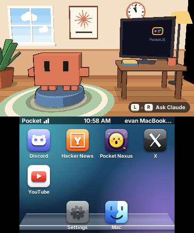
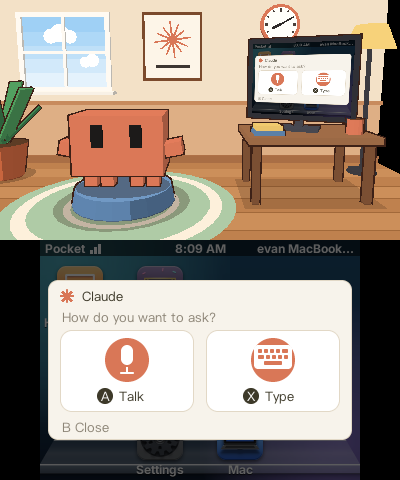
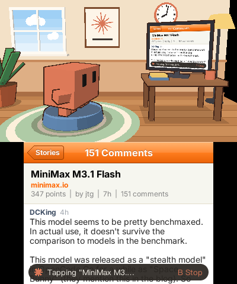
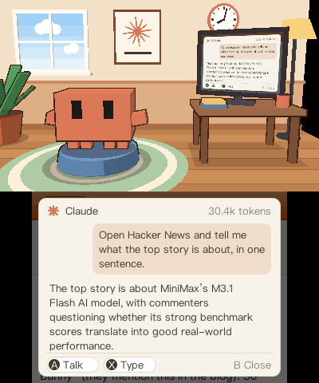

# Pocket Shell on the 3DS

The 3DS shell is **Pocket Home**, the console's launcher, and the apps it
ships with. Every app draws on the touch screen and nowhere else. The top
screen belongs to the system: for each app that declares the capability
`system.agent`, the PocketJS 3DS host draws Claude's room there, and **L+R
opens the agent over any app**. The runtime side (the room, the overlay, the
companion's agent) is PocketJS's and is described in
[POCKET-AGENT.md](../../vendor/pocketjs/docs/POCKET-AGENT.md) in the pinned
submodule.

| Home | L+R | The agent at work | The reply |
| --- | --- | --- | --- |
|  |  |  |  |

These are screenshots from an Old 3DS. The third and fourth come from one
typed request ("Open Hacker News and tell me what the top story is about"),
which took **30.4k tokens**.

## Apps

| App | Directory | Package | Reaches the console |
| --- | --- | --- | --- |
| Pocket Home | `home/` | `dev.pocket-nexus.home`, `home-main` | embedded in the `.3dsx`; the launcher |
| Hacker News | `hn/` | `dev.pocket-nexus.hn`, `hn-main` | installed through Home from the linked Mac, or pushed |
| YouTube | `youtube/` | `dev.pocket-nexus.youtube`, `youtube-main` | the same |
| X | `x/` | `dev.pocket-nexus.x`, `x-main` | the same |
| Discord | `discord/` | `dev.pocket-nexus.discord`, `discord-main` | the same |

`ui/` is the iOS 6 kit both apps build on at the 3DS's 0.82 scale: the
navigation stack and bar, grouped tables, alerts, text fitting, a slot pool
for long lists and one stylus router per screen.

**Home** is the springboard, Settings (Wi-Fi, Mac pairing by QR code, the
Mac's app catalog) and the clock, which reads the Mac's time over the Pocket
Link. The springboard holds **four columns by two rows a page** above a
two-icon dock. Labels are bold 10 px (`text-2xs`), so "Hacker News" and
"Pocket Nexus" fit their 80 px cells; a longer name ends in "...".

- A drag moves the row of pages with the stylus. A flick faster than
  **250 px/s** turns the page; a slower release settles on the nearest page.
  Past the first or last page the row resists (a 160 px pull moves it 69 px).
- The d-pad's left and right turn the page at the grid's edges. L and R do
  not page: a lone shoulder press reaches an app six frames late, because the
  host waits that long for the L+R chord.
- Page dots above the dock follow the drag.

**Icons are rendered at 512 px and finished at their size.**
`home/art/icons/icons.py` models Settings, Hacker News, Wi-Fi and Apps in
Blender as lit objects on lacquer or metal plates, and Mac as a two-tone
lacquer face after the Finder (a raised profile line, enamel eyes and
smile), with few large shapes so they hold at 46 and 24 px. Pocket Nexus is the face "O" of the Pocket
Nexus wordmark, drawn by the wordmark's own code (PocketJS
`apps/nexus/art/draw.js`, run in headless Chrome by `home/art/icons/nexus.ts`).
`home/art/icons/bake.ts` gives all of them one finish (the rounded mask, the
iOS 6 gloss, a lit top rim, a shaded bottom rim and, at 46 px, a drop
shadow), sharpens them after the downsample and writes 24, 46 and 64 px
textures. The build reads the committed
PNGs, so it needs no Blender. Cycles output differs a little between runs, so
a re-render is a new set of pictures to review, not a check.

**YouTube, X and Discord** reach their services through the linked Mac:
each app fetches `https://companion.pocket/<service>/…`, which Pocket
Companion answers itself (PocketJS `tools/companion/services/`). Accounts,
tokens and tools stay on the Mac; the console never holds them.

- **YouTube** lists topic feeds and search results from yt-dlp, with
  thumbnails the companion renders into textures. The Mac needs yt-dlp and
  ffmpeg (`brew install yt-dlp ffmpeg`). A New 3DS plays H.264
  through its hardware decoder; an **Old 3DS plays 240×136 at about 12 fps**
  in PAL8 (a fixed 252-colour cube, only changed pixels sent), with sound,
  at 58 to 215 KB/s. Sound needs the console's DSP firmware once: Rosalina
  menu (L + Down + SELECT) > Miscellaneous options > Dump DSP firmware.
- **X** reads the Following and For You timelines and threads through the
  session of an account signed in on the Mac: `bun tools/companion.ts
  service x login` opens a sign-in window there. It uses x.com's web API,
  which X changes without notice.
- **Discord** reads and sends in the servers a bot is in: create a bot in
  the Discord developer portal, turn on its Message Content intent, then
  `bun tools/companion.ts service discord token <token>`, and `service
  discord status` prints the invite link.

**Hacker News** lists Top, New, Best, Ask and Show and opens a thread with
the story and every comment in full. Its requests go through
`@pocketjs/framework/net`, which on the 3DS rides the Pocket Link to the Mac.

## The agent

L+R opens a card over the paused app with two choices: **Talk (A)** records
until A or Send, and **Type (X)** opens the keyboard; START sends. While the
agent operates the app the card shrinks to a banner and B stops it. On the
top screen the mascot listens, thinks and types at its own monitor, which
shows the touch screen or the agent's own copy of an app, and the Pocket3D
mark as a screensaver while it rests. A pill in the
bottom-right corner reads "L+R Ask Claude" while the mascot is idle.

The agent needs **Pocket Companion** on the Mac, signed in to Codex: run
`bun tools/companion.ts serve` in a PocketJS checkout, or build the menu bar
app there with `bun run companion:app`. `bun run offer` puts this shell's
apps in the companion's catalog.

## Commands

Run from the repository root.

```sh
bun run deploy --host <console-ip>      # build home-main.3dsx, install it over the wire, restart into it
bun run push --host <console-ip>        # rebuild Home's package and hot-push it
bun run push hn --host <console-ip>     # rebuild Hacker News, install it into its slot and start it
bun run offer                           # build the apps' packages and offer them through the companion
bun run shot --host <console-ip>        # one screenshot of both screens
bun run 3ds [home|hn] [--pocket-only]   # build into dist/3ds
bun run --cwd shells/3ds icons          # re-render and re-bake Home's icons (macOS, Blender 5)
bun run check:3ds                       # typecheck, the Home and Hacker News sims, unit tests
```

A change under `home/`, `hn/` or `ui/` reaches a console with `push`. A
change in the runtime (`vendor/pocketjs/hosts/3ds`) needs `deploy`. Pairing
needs ftpd once: `bun run pair --host <console-ip>`. The `.3dsx` is the only
console format.

Home's recovery state is in `/pocketjs/runtime/apps/<slot>/`, where the slot
is the first 16 hex digits of the SHA-256 of `dev.pocket-nexus.home`.
