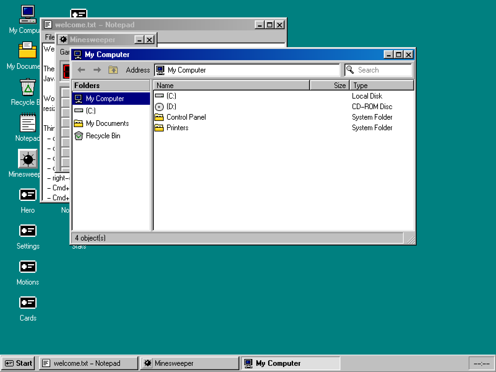
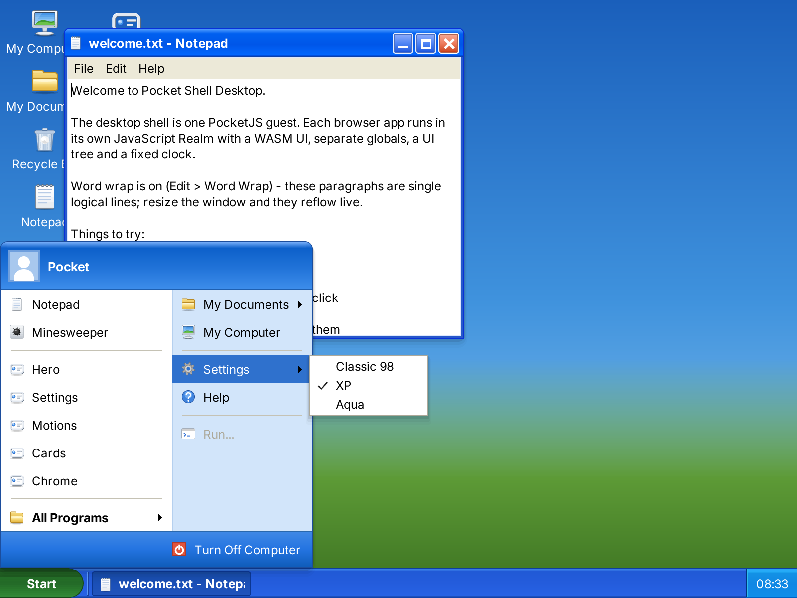
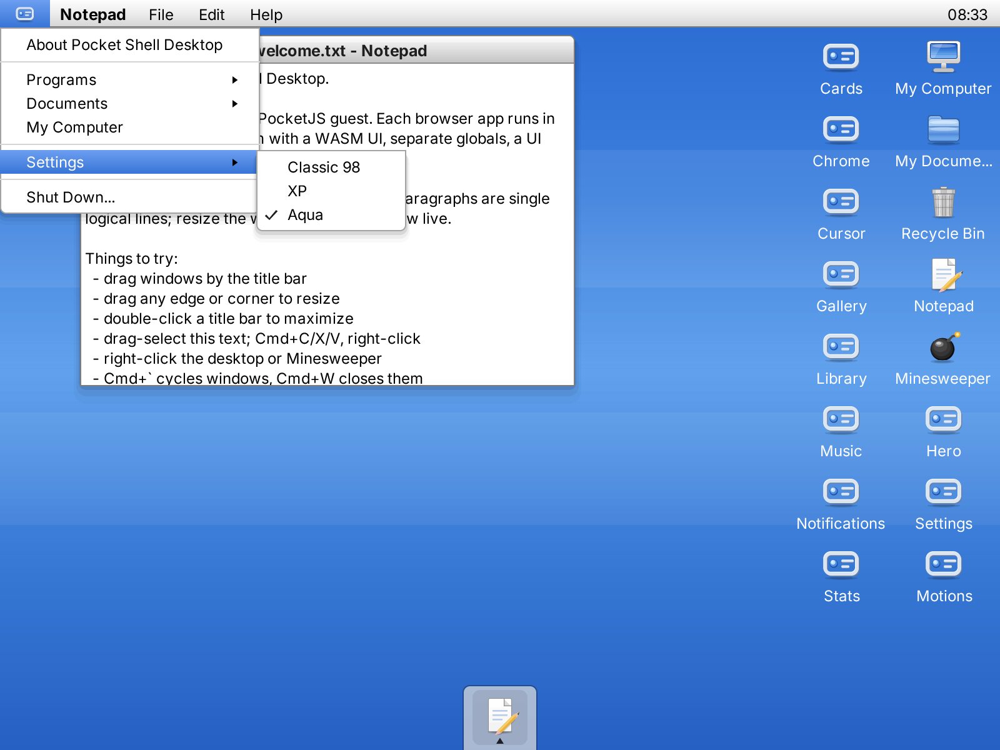

# Pocket Shell Desktop

Pocket Shell Desktop is the desktop interface in [Pocket Shell](../../README.md).
It runs in the browser preview and on computers embedded in Pocket Studio's
rooms. The System UI uses SolidJS and PocketJS's renderer; it owns windows,
taskbar, application presentation and theme selection. The browser host owns
AppInstance isolation, scheduling and composition. An embedding product owns
its display, input and application services.

## Themes

Pocket Shell Desktop ships three System UI themes: Classic 98, XP and Aqua.
Each is a period desktop rebuilt from PocketJS-native drawing — no bitmaps of
the originals, no theme-specific code paths outside the theme's own
definition. **All three run on the same System manifest, AppInstances and
browser compositor.**

| Classic 98 | XP | Aqua |
|---|---|---|
|  |  |  |

- **Classic 98** — hard two-ring bevels, 18px captions, a 28px taskbar with
  the Start rail menu, the W95FA bitmap face, native 32px pixel-art desktop
  icons and Explorer's coolbar and "Folders" pane in the file manager.
- **XP** — Luna chrome: three-stop gel gradients under 1px
  highlight and seat strips, top-rounded window frames, the two-column Start
  panel (user header, pinned programs, places, Turn Off Computer), a baked
  green Start pill, softly shaded Luna-style vector icons, and the Explorer
  task pane with its "Other Places" card. Text is baked from Inter, since
  Tahoma cannot be redistributed.
- **Aqua** — gel traffic lights on the left of a glossy caption
  that goes matte when unfocused, the menu bar hoisted to a 22px screen bar
  (launcher logo, program name, menus, clock), a translucent Dock, desktop
  icons hanging from the right edge, blue-gradient highlights, pale-blue text
  selection, white gel push buttons, and Tiger's toolbar pills, breadcrumb,
  round search well and sidebar in the file manager. Its lights and small
  gels are baked artwork, because the renderer bands gradient fills inside
  small rounded boxes.

The shell underneath is headless: every part — caption, control cluster, menu
bar, launcher, task strip, popups, selections, dialogs, the file manager's
toolbar and places sidebar — is one semantic slot the active theme fills with
its own paint and, through its chrome metrics, its own placement (controls
left or right, menus in the window or on the screen bar, a task strip or a
Dock). The window manager hit-tests from the same metrics, so switching
themes keeps every client rectangle, caret and compositor surface exact. The
Pocket app icon is the PocketJS favicon mark, cut from Aqua silver-and-blue
or Luna silver per theme.

The same contract covers what a program draws inside its window: list boxes
and their rows, a scroll mark, group frames, value wells, radio marks,
progress bars and push buttons. The Shut Down dialog draws its radio marks
from it. A Pocket app that imports `src/system-ui/theme.ts` draws its own
window from the same parts, and bakes the five theme font slots and the icon
set into its own pack the way the System UI does (`src/system-ui/pak.json`,
`src/system-ui/icons/`). The host tells the app which theme is active; the
`theme` lines below carry it.

Choose a theme from **Start → Settings** (the logo menu on Aqua), or press
**Cmd+Shift+T** to cycle while testing.

## Architecture

```text
pocket.system.json
  ├─ roles.systemUI → dev.pocket-nexus.desktop.system-ui
  ├─ installation snapshot
  └─ installed Pocket app catalog
             ↓
      ResolvedSystemPlan
             ↓
  PocketJS browser System host
      ├─ one iframe Realm and WASM UI per AppInstance
      ├─ fixed-step scheduling, focus and child surface composition
      └─ io.offload workers: WASM text layout with package font bytes
```

The System UI is in `src/system-ui`. Demo applications are consumed from the
pinned `vendor/pocketjs` submodule and are not copied into this product.

The System UI takes the desktop's name from the System manifest's `title`. The
Aqua screen bar with no window focused, the About dialog and its menu entries,
and the welcome note show it, so a product that installs this System UI under
its own `pocket.system.json` gets its own name in each of them.

The About dialog's text comes from `pocket.about.json` beside the System
manifest, because the manifest schema has no field for product copy:

```json
{
  "body": ["One line of text.", "Another line."],
  "link": "example.org/product"
}
```

`body` holds one text line per entry; the dialog does not wrap them and its
fixed size holds four above the link. `link` is shown as text under the body.
Both fields are optional. This repository's file describes the shell; a
product that bundles the System UI replaces the file with its own.

The same file sets the prefix of an installed app's window title, shown in the
window's caption and its task button as `<prefix>: <app title>`:

```json
{
  "windowTitlePrefix": "My Desktop"
}
```

**A file without `windowTitlePrefix` gives `PocketJS`**, so the Hero window
reads `PocketJS: Hero`. An empty string titles the window with the app's title
alone. The System UI's own windows (Notepad, Minesweeper, the folders, About)
take no prefix.

The host and the System UI exchange JSON lines over the `system-ui` companion
service; `src/system-ui/svc.ts` lists every line. Besides input, the host can
send two lines:

- `{t:"open", package}` opens an installed app by package id. When that app's
  window is already open, the line restores it if it is minimized, raises it
  and focuses it. A package id outside the installed catalog is ignored.
- `{t:"theme", id}` selects the theme with that id: `classic`, `xp` or `aqua`.
  An id that names no theme is ignored.

The System UI sends `{t:"theme", id}` to the host once after boot and after
every frame that ends in another theme, whether the Settings menu, the cycle
chord or the host's line changed it. A host that keeps the user's choice or
passes the theme on to its apps reads this line.

The root `vendor/pocketjs` submodule pins the framework and browser runtime.
The browser program is `programs/web/system-engine.js`; its AppInstances use
`platforms/web` and the WASM UI core. A fresh `setup` uses the pinned commit.

Notepad sends revisioned incremental edits through `io.offload`; Rust performs wrapping
on a worker and returns bounded pages. Rendering and hit testing share an
accepted source/geometry snapshot. Long documents render only visible rows.
The OpenType service uses COSMIC Text/Harfrust/Swash with explicitly supplied
font bytes, including on WASM. No system font discovery occurs.

See [the text capability and companion contract](docs/PORTABLE-TEXT.md) for
pairing, budgets, current limits and validation.

## Assets

Icons and 1×/2× font atlases are generated before browser and simulator
builds. Only their generators and original font inputs are tracked. Use
`bun run desktop assets` to rebuild them explicitly; see the
[repository asset policy](../../docs/ASSETS.md).

## Build

Run these commands from the repository root. Outputs are relative to
`shells/desktop/`. Use the Bun version in `.bun-version` and the Rust toolchain
in `vendor/pocketjs/rust-toolchain.toml`, with `wasm32-unknown-unknown` installed.

```sh
bun run setup
rustup target add wasm32-unknown-unknown
bun run desktop check
bun run desktop test:rust
bun run desktop build:web
bun run desktop web
bun run desktop test:web
```

The browser host runs each installed package in an independent iframe Realm
with its own WASM UI instance and text Worker. It schedules AppInstances and
composites their rasters at the shell's `CompositorSurface` painter positions.
`test:web` opens Hero in headless Chrome and waits for the child raster before
saving `dist/web-smoke.png`.

Build and verify the site, including the preview at `/play/`:

```sh
bun run desktop build:site
bun run desktop test:site
```

The retained Wrangler configuration targets Cloudflare Workers Static Assets
at `desktop.pocketlab.build`. `bun run desktop deploy:site` builds and publishes
the site when a deployment is requested. Theme documentation images can be
regenerated with `bun run desktop capture`.

## Embed a Studio computer

**`pocket.app.studio.json` is the Studio computer's application contract.**
An embedding product compiles it against its own host contract and runs the
resulting `.pocket` package through PocketJS's shared runtime. The product
supplies the screen texture, input and the `system-ui` and `pocket-studio`
services. The shell supplies the desktop interface and themes.

```sh
bun run desktop assets
bun vendor/pocketjs/tools/pocket.ts compile \
  --manifest shells/desktop/pocket.app.studio.json \
  --project-root shells/desktop \
  --target /path/to/product/pocket.host.json \
  --output /path/to/product/desktop.pocket
```

A host that provides `pocket-studio` enables Agent Check, Studio Settings and
My Games. Their values and actions belong to the embedding product. Browser
Studio can also stage the System UI with its own `pocket.system.json`, About
text and application catalog. Neither embedding uses a standalone desktop
executable from this repository.

## Licensing

This desktop shell is distributed under **GPL-3.0-only**. The full terms are
in [LICENSE](LICENSE); third-party materials retain the licenses in
[THIRD_PARTY.md](THIRD_PARTY.md). Contribution rules and the licenses of the
other shells are described in [CONTRIBUTING.md](../../CONTRIBUTING.md) and
[LICENSING.md](../../LICENSING.md).
